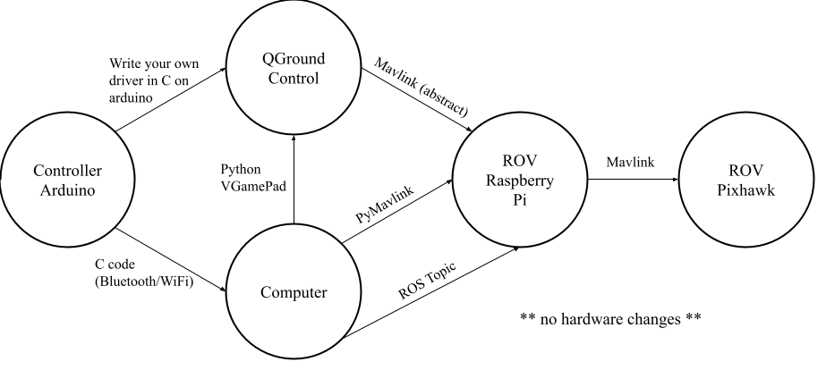

# Software Planning 

## Communication Pipeline Options

    

#### Current Pipeline choice
- [ ] Controller Arduino
- [ ] C Code (over Bluetooth)
- [ ] Computer
- [ ] ROS Topic
- [ ] ROV Raspberry Pi
- [ ] Mavlink
- [ ] ROV Pixhawk

## Communication Pipeline Comparisons

| **ROS topic**    (code on ROV)  | **Python VGamepad** | **Python Mavlink**    (code on PC)  |
| --- | --- | --- |
| <ul><li>Most of code is running on ROV </li><li> Program your own complex behavior</li></ul>|<ul><li>'Plug and Play'</li><li>Not super customizable</li><li>Need separate pipeline for non-flight controller actions</li></ul>|<ul><li>Program your own complex behavior</li><li>Most of code on PC</li></ul>|

## Software Schedule
**Phase 1**
1. Connect ROV Pi and Pixhawk
1. Install BlueOS
1. Connect Pi to QGroundControl
1. Send commands via QGroundControl - Pi - Pixhawk

**Phase 2**
1. Install ROS on ROV Pi, FoxGlove (ROS GUI) on PC
1. Establish communication between PC and Pi
1. Establish communication between Pi and Pixhawk with Mavlink

**Phase 3**
1. Build up ROS code for all funcitonalities

**Note:** After Phase 2, communication pipeline is fully established!
