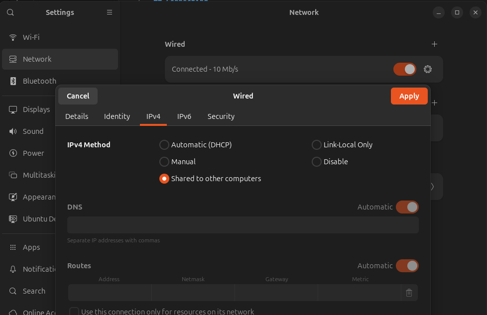

# Pi Setup / Connection Guide

## Configuration Details

USER: `rat`
PASS: `rat`
HOSTNAME: `blueos`
CONNECTION STRING: `rat@blueos.local`
DEFAULT IP: `192.168.2.2/24`
BLUEOS WEB URL: `http://blueos-avahi.local/` (or substitute the IP for hostname)


## Connecting

The Pi is configured to automatically obtain an IP address via DHCP. **It has not been configured to use WiFi yet.** There are several means of connecting.

The recommended setup is to connect the Pi directly to your laptop via ethernet. Configure your laptop's ethernet connection to share internet connection:



Run `ip -br a` to see your IP address:
```
> ip -br a
...
eth0        UP             10.42.0.1/24
...
```

Since the Pi is configured with DHCP, it should automatically receive an IP address in the same range as your host, such as `10.42.0.200`.

Test connectivity via `ping blueos.local` or `ping {ip-address}`.

Connect via ssh:
`ssh rat@blueos.local` or `ssh rat@{ip-address}`

Upon connecting, test that the internet-passthough works by running `ping 8.8.8.8`.

If you don't want to connect host-to-host, you can connect the Pi to a home router via ethernet. It should automatically receive an IP address via DHCP. Use `nmap` or router admin panel to identify the device.

**IMPORTANT NOTE:** BlueOS is configured to have the IP `192.168.2.2` by default. If DHCP doesn't appear to work, you can try manually adding an IP to your host laptop with `ip addr add 192.168.2.1/24 dev eth0` and connect to `192.168.2.2`.

## Docker Setup

Helpful commands (run as `sudo`):
- `docker images` - Show docker images
- `docker ps` - Show running docker containers


## Troubleshooting

#### 

#### BlueOS Docker Container 

If you can't access internet services on the web page (ie. installing extensions), or `docker pull` gives an error like:
```
Error response from daemon: Get "https://registry-1.docker.io/v2/": dial tcp: lookup registry-1.docker.io on [::1]:53: read udp [::1]:38378->[::1]:53: read: connection refused
```

Try running:

```
sudo rm /etc/resolv.conf
sudo bash -c 'echo -e "nameserver 1.1.1.1\nnameserver 8.8.8.8" > /etc/resolv.conf'
sudo systemctl restart docker 
```
